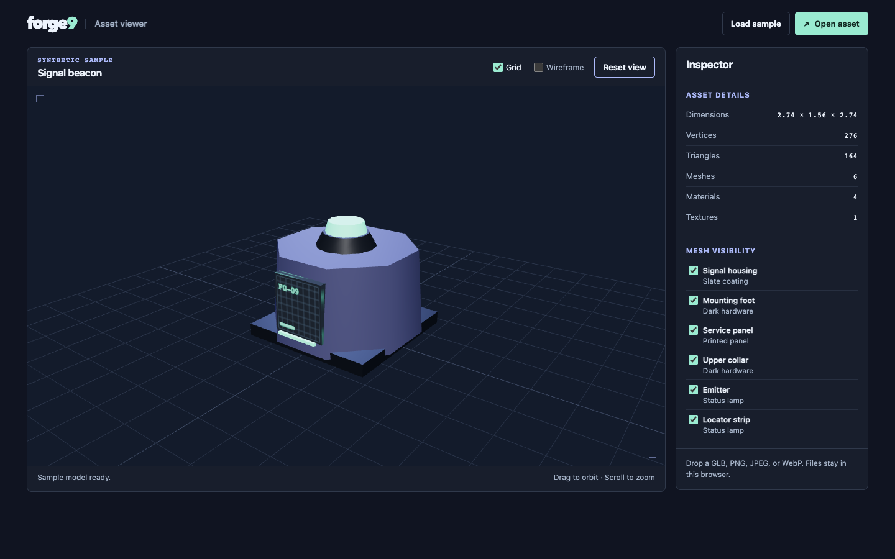

# Forge9 asset viewer



The local viewer opens self-contained GLB models and PNG, JPEG, and WebP
textures. Orbit and frame the model, inspect mesh and material counts,
and switch between solid and wireframe views. The sample is generated in
the viewer, so you can try it without an archive.

From the Forge9 checkout, with Node.js 20.19+ or 22.12+:

```bash
npm --prefix viewer ci
npm --prefix viewer run dev
```

Open the loopback URL printed by Vite. Pick or drop a file directly in the
viewer. The file is read by the tab. The viewer bundles its dependencies
and loads GLB resources from the selected file.

To inspect an asset from your own local archive, export it with Forge9:

```bash
forge9 --data-dir ./data model models.rpf 12 -o model.glb
forge9 texture store.ttpf --decode 12 -o texture.png
```

Replace the paths and entry indices with yours. Forge9 uses its local
key files when opening RPF9 archives. The viewer takes only the exported
model or image. Use GLB for embedded image maps. Export a texture-store
entry as PNG to preview it in the viewer.

Run `npm --prefix viewer run build` to generate the static viewer.

Model fidelity depends on the available drawable parts, texture bindings,
and decoder coverage. See the [drawable notes](../docs/drawable_format.md)
for current material, skinning, and vehicle fragment coverage.

To distinguish a material with empty bindings from a binding unresolved in
your texture stores, run the read-only material report:

```bash
forge9 --data-dir ./data model models.rpf 12 --materials-json > materials.json
```

A material with no decoded texture references has an empty `bindings`
array. A reference whose key has no match in the open stores has a
`null` source. The report checks index matches, and records skipped
geometries, before any texture decode or model export.
